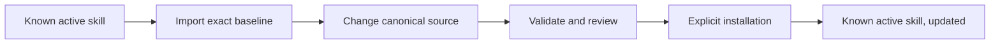

# Canonical Sources and Installation

[ALP Skills Book](../README.md) · Previous:
[Repository Charter](repository-charter.md) · Next:
[Legacy Reconciliation and LLM Wiki](legacy-reconciliation-and-llm-wiki.md)

## Why keep a canonical source tree?

Installed skills are convenient: they are the copy an agent uses today. They
are a poor place to develop a change. A direct edit can be forgotten, overwrite
a local adjustment, or leave no reviewable answer to the simple question,
“What exactly did we install?”

The canonical source tree separates making a change from using it. It gives the
change a visible home, lets review and tests run against the same files that
will be released, and makes installation a deliberate last step instead of an
accident of editing a live directory.



## A layout that matches how the tools find things

The tree mirrors the two tools' native discovery structure. This is not an
abstraction exercise: when a reviewer sees a source file, its intended kind of
target is obvious.

```text
codex/
  skills/
    alp-workflow/
    alp-authoring/
  agents/
    alp_explorer.toml
    alp_verifier.toml
    alp_tangler.toml
    alp_implementer.toml
    alp_reviewer.toml
    alp_escalation_reviewer.toml
antigravity/
  skills/
    alp-contract-implementation/
book/
wiki/
tools/
```

The first source-management release imports an exact baseline of active skill
instructions, metadata, references, helper scripts, and deterministic helper
tests. Disabled legacy profiles are historical evidence, not active source
definitions.

| Canonical source | Configured target |
| --- | --- |
| `codex/skills/<name>/` | The local Codex skill directory. |
| `codex/agents/alp_*.toml` | The local Codex agent-profile directory. |
| `antigravity/skills/<name>/` | The local Antigravity skill directory. |

The Book deliberately names target kinds rather than one machine's paths. The
knowledge-lifecycle design will define how a clone discovers its own local
bindings without turning personal configuration into portable documentation.

## Why synchronization is worth having

Synchronization is a safety rail, not a background updater. Without it, a
person can copy the wrong revision, overwrite a local modification, or mistake
a missing file for a working installation. A small manifest answers three
practical questions before it writes anything:

1. Which files does this repository actually manage?
2. Does the installed copy match the reviewed source, differ from it, or not
   exist yet?
3. If it differs, has the user explicitly agreed to replace it?

The normal command first reports a sorted `missing`, `matching`, or `drifted`
status and writes nothing. A dry run shows the exact managed files an
installation would affect. Only an explicit apply action may create a missing
target or replace a drifted one; replacing drift requires a separate
acknowledgement and a recoverable backup.

The command manages only the reviewed manifest. It must not follow a symlink
outside a configured target root, delete an unmanaged file, or touch secrets,
caches, unrelated configuration, or non-ALP skills. After an interrupted copy,
the prior target or its backup remains available for recovery.

## Identity and evidence

The manifest records a repository revision and a SHA-256 digest for each
managed source file. An installation receipt records which revision reached a
particular local target without storing credentials, prompts, session IDs, or
worker output. Together they make a later drift report explainable rather than
just alarming.

## Acceptance for this capability

The source-management implementation is ready when it can import an exact
baseline, validate the canonical helpers, parse the relevant metadata, and
exercise missing, matching, drifted, invalid-manifest, symlink-escape,
interrupted-copy, and overwrite-refusal cases without touching a live target.
Live installation remains a separate user-approved operation.

---

[ALP Skills Book](../README.md) · Previous:
[Repository Charter](repository-charter.md) · Next:
[Legacy Reconciliation and LLM Wiki](legacy-reconciliation-and-llm-wiki.md)
