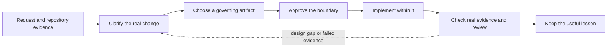

# Delivery Workflow

[ALP Skills Book](../README.md) · Previous: [What Is ALP?](what-is-alp.md) ·
Next: [Authoring ALP Books](authoring-alp-books.md)

## The workflow is a feedback loop

An AI agent is very good at filling in gaps. That is useful for routine work,
but dangerous when a gap is really an unanswered design question: the agent can
make a plausible assumption, write code that looks right, and even create tests
that confirm its own assumption. A workflow gives the work a feedback loop so
that intention, implementation, and evidence can challenge one another.

The point is not to manufacture paperwork. It is to stop an agent from quietly
choosing behavior that the user never wanted, and to make sure the result works
in the way that matters rather than merely looking convincing in a diff.

## Pick the amount of design that helps

| Strategy | What the reader and agent receive | Choose it when |
| --- | --- | --- |
| Full ALP | A reader-first, tangle-ready Book chapter. | The author can invest in teaching the design and material behavior must not be invented during implementation. |
| Spec-driven | A focused behavioral or technical specification. | The work needs a clear target, but ordinary implementation choices can remain open or time does not support a full Book. |
| Mechanical | An explicit statement that no new governing document is needed. | The change is small, behaviorally obvious, and local guidance allows it. |

Full ALP does not promise bug-free code. It removes material design invention:
if a tangler would need to choose an architecture, interface, failure policy,
or materially different algorithm, the Book needs improvement before coding
continues.

## Evidence is how we keep ourselves honest

Every material behavior needs a visible definition of success and a credible
way to observe it. Tests are often the best way to do that, especially when a
meaningful executable oracle can be prepared before implementation. They give
an AI concrete feedback instead of asking it to judge its own output.

But an executable test is not automatically a good oracle. A made-up harness
can test the agent's invented interpretation rather than the real requirement;
in a production or legacy system it can also be unsafe, impractical, or simply
irrelevant. In those cases, the honest oracle may be static review, a manual
check, runtime observation, telemetry, rollback evidence, or an operator
procedure. The important rule is to name the real limitation rather than claim
test coverage that does not exist.

TDD is therefore encouraged wherever it gives useful feedback. It is not a
universal ritual that overrides a stronger real-world oracle.

## Put judgment where it is worth the cost

People using AI agents usually have limited time, money, or model credits. The
workflow treats those resources as something to spend deliberately, not as a
reason to make every task shallow.

The root session keeps the expensive, high-judgment work: conversation with the
user, material decisions, approval boundaries, acceptance meaning, and final
synthesis. Bounded workers can do exploration, structured extraction,
deterministic checks, a tangle, implementation, or a fresh review. Their names
describe capability rather than status or a permanent model family.

| Capability | Why it exists |
| --- | --- |
| Explore and verify | Let a cheaper or fresher worker inspect broad evidence and return a compact packet. |
| Tangle or implement | Turn an approved Book or specification into code without reopening settled design. |
| Review | Give a fresh reader the chance to find a mismatch between intent, code, and evidence. |
| Escalate | Spend stronger review capacity only when risk or a weak oracle justifies it. |

This is also why the workflow can use more than one tool. A different tool or
model may offer cheaper implementation capacity, an independent review, or a
separate credit pool. The handoff must still carry the governing artifact,
boundary, and test semantics; changing tools must not turn settled intent into
a guessing game.

## The four habits

1. **Brainstorm.** Clarify goal, non-goals, risks, compatibility, and the
   appropriate strategy before non-trivial work begins.
2. **Write the governing artifact.** Teach the design in a Book or state the
   specification precisely enough for the approved implementation route.
3. **Implement the approved boundary.** Stop rather than silently broaden it
   when new material judgment is required.
4. **Review and remember.** Check the governing artifact, final change, and
   independent evidence; then keep a lasting lesson only when it will help the
   next task.

An EC contract is available when a fresh or external implementer needs a compact
self-contained handoff. It carries the approved decisions, invariants,
acceptance, validation, file boundary, and unresolved questions. It is a
bridge, not a substitute for the governing Book or specification.

---

[ALP Skills Book](../README.md) · Previous: [What Is ALP?](what-is-alp.md) ·
Next: [Authoring ALP Books](authoring-alp-books.md)
