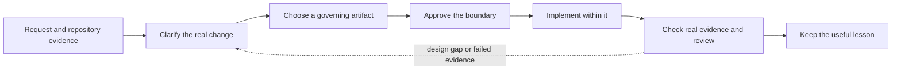
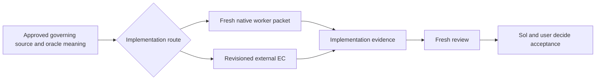

# Delivery Workflow

[ALP Skills Book](../README.md) · Previous: [What Is ALP?](what-is-alp.md) ·
Next: [Authoring ALP Books](authoring-alp-books.md)

## The workflow is a feedback loop

An AI agent is very good at filling in gaps. That is useful for routine work,
but dangerous when a gap is really an unanswered design question: the agent can
make a plausible assumption, write code that looks right, and even create tests
that confirm its own assumption. A workflow gives the work a feedback loop so
that intention, implementation, and evidence can challenge one another.

The point is not to manufacture paperwork. It is to stop an agent from quietly
choosing behavior that the user never wanted, and to make sure the result works
in the way that matters rather than merely looking convincing in a diff.

## Pick the amount of design that helps

| Strategy | What the reader and agent receive | Choose it when |
| --- | --- | --- |
| Full ALP | A reader-first, tangle-ready Book chapter. | The author can invest in teaching the design and material behavior must not be invented during implementation. |
| Spec-driven | A focused behavioral or technical specification. | The work needs a clear target, but ordinary implementation choices can remain open or time does not support a full Book. |
| Mechanical | An explicit statement that no new governing document is needed. | The change is small, behaviorally obvious, and local guidance allows it. |

Full ALP does not promise bug-free code. It removes material design invention:
if a tangler would need to choose an architecture, interface, failure policy,
or materially different algorithm, the Book needs improvement before coding
continues.

## Evidence is how we keep ourselves honest

Every material behavior needs a visible definition of success and a credible
way to observe it. Tests are often the best way to do that, especially when a
meaningful executable oracle can be prepared before implementation. They give
an AI concrete feedback instead of asking it to judge its own output.

But an executable test is not automatically a good oracle. A made-up harness
can test the agent's invented interpretation rather than the real requirement;
in a production or legacy system it can also be unsafe, impractical, or simply
irrelevant. In those cases, the honest oracle may be static review, a manual
check, runtime observation, telemetry, rollback evidence, or an operator
procedure. The important rule is to name the real limitation rather than claim
test coverage that does not exist.

TDD is therefore encouraged wherever it gives useful feedback. It is not a
universal ritual that overrides a stronger real-world oracle.

## Put judgment where it is worth the cost

People using AI agents usually have limited time, money, or model credits. The
workflow treats those resources as something to spend deliberately, not as a
reason to make every task shallow.

The root session keeps the expensive, high-judgment work: conversation with the
user, material decisions, approval boundaries, acceptance meaning, and final
synthesis. Bounded workers can do exploration, structured extraction,
deterministic checks, a tangle, implementation, or a fresh review. Their names
describe capability rather than status or a permanent model family.

| Capability | Why it exists |
| --- | --- |
| Explore and verify | Let a cheaper or fresher worker inspect broad evidence and return a compact packet. |
| Tangle or implement | Turn an approved Book or specification into code without reopening settled design. |
| Review | Give a fresh reader the chance to find a mismatch between intent, code, and evidence. |
| Escalate | Recommend stronger review when risk or a weak oracle warrants it; use the Sol escalation reviewer only after explicit user authorization. |

Delegation must buy a concrete benefit: cheaper substantial work, protection of
the small root context, compression of noisy evidence, genuinely independent
judgment, useful latency, or access to a separate external capacity. Compare
that benefit with briefing, reconciliation, drift, and repair cost. Repository
work still belongs with a worker because Sol does no repository work; the value
gate decides whether to split another bounded task, which capability to use,
and whether the native or external route is worth its handoff overhead.

## Choose an implementation route

Implementation commonly follows one of two routes. The route is selected
after the governing source, scope, and oracle meaning are approved; changing
route does not change those decisions.

Strategy authority comes first. Full ALP implementation tangles the approved
Book and stops if material design judgment is still required. Spec-driven
implementation may exercise only the ordinary discretion left open by the
approved specification. Mechanical work remains limited to the small,
behaviorally unambiguous change approved in Brainstorm. Native and external
routes must preserve those distinctions.

| Route | Best fit | Travelling context |
| --- | --- | --- |
| Native Codex worker | Bounded internal work that benefits from a fresh, smaller context and compact return. | A narrow native packet containing the role or capability, task and file boundary, relevant paths or evidence, permissions, stop conditions, and response needs. |
| Manual or external handoff | Work copied or handed to Antigravity or, when appropriate, Gemini Flash without access to the Codex conversation. | A complete, revisioned Execution Contract that is self-contained enough to plan, implement, and report conflicts against the approved governing source. |

The routes share the governing source, closed task and file boundary,
independently owned test or oracle semantics when practical, conflict-stop
behavior, implementation evidence, and root/user acceptance authority. They do
not share one transport or envelope template. Native packet behavior belongs
to [Native Worker Delegation](worker-dispatch.md); manual and external mechanics
belong to [Execution Contracts and Evidence](execution-contracts-and-evidence.md).

## Review once, then preserve what matters

Both routes converge on the same fresh review. The reviewer receives the
stated session goals, governing source, final diff, and independent evidence
before any implementation walkthrough. Missing or materially ambiguous session
goals produce a blocked review rather than an invented standard.

Each finding states severity, exact evidence, the affected criterion or
invariant, why acceptance is not yet justified, a closure condition, and
whether it is deferrable without affecting the stated session goals: yes, no,
or uncertain with a reason. That classification does not defer or accept the
finding; only Sol and the user can do so.

A fresh deterministic verifier may substitute for Terra only for read-only
documentation or data work with a fully deterministic oracle and no material
interpretation, conflict resolution, policy choice, or acceptance judgment.
Otherwise Terra reviews. Reconciliation happens once unless a concrete blocker
requires another correction. Wrap Up then changes TODO, wiki, indexes, or logs
only when accepted work created a durable lesson or fulfilled follow-up; it is
not bookkeeping performed merely to prove activity.

When the best available oracle remains weak, the review labels its limitation
and residual risk. Sol may recommend a separately user-authorized escalation
review; weakness never triggers one automatically. Sol and the user then decide
whether to return to an earlier phase, add an approved assurance measure, or
accept the explicitly labelled gap.

## The four habits

1. **Brainstorm.** Clarify goal, non-goals, risks, compatibility, and the
   appropriate strategy before non-trivial work begins.
2. **Write the governing artifact.** Teach the design in a Book or state the
   specification precisely enough for the approved implementation route.
3. **Implement the approved boundary.** Stop rather than silently broaden it
   when new material judgment is required.
4. **Review and remember.** Check the governing artifact, final change, and
   independent evidence; then keep a lasting lesson only when it will help the
   next task.

An EC is the active handoff contract for the manual or external route. It is a
bridge, not a substitute for the governing Book or specification, and native
workers do not need to carry its external-tool envelope.

---

[ALP Skills Book](../README.md) · Previous: [What Is ALP?](what-is-alp.md) ·
Next: [Authoring ALP Books](authoring-alp-books.md)
