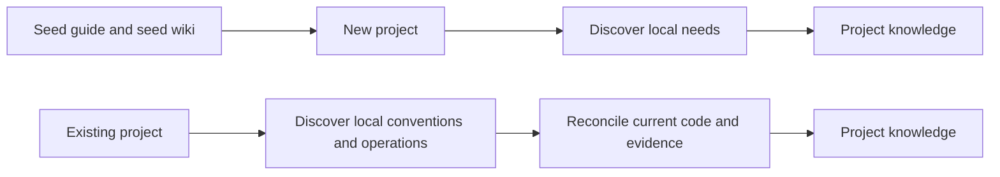

# Legacy Reconciliation and LLM Wiki

[ALP Skills Book](../README.md) · Previous:
[Canonical Sources and Installation](canonical-sources-and-installation.md) ·
Next: [TODO](../TODO.md)

## The Book and the wiki solve different problems

The Book is the human-facing explanation of the system and, for Full ALP, the
source that constrains an AI-assisted tangle. It teaches intent, decisions, and
material behavior. It must stay readable enough that a person can understand
the system without reconstructing it from code or old conversations.

The wiki is not another Book. It is a repository-local memory layer for agents:
a compact place to retain reconciled lessons, source provenance, and useful
wrap-up knowledge that would otherwise disappear between sessions or be absent
for someone who clones the repository. It is inspired by the LLM-wiki idea of
processing source material once into navigable knowledge, rather than asking
each new agent to rediscover everything from raw files.

The boundary is strict: a wiki page can point to the Book and explain evidence,
but it cannot quietly define or change governing behavior. When a lesson changes
design, the Book changes first.

## Why a seed wiki belongs in the method

An empty repository gives a new agent no local orientation. A seed wiki and a
small repository guide give it a starting mental model: how the Book is used,
how durable knowledge is kept, and how to distinguish current guidance from
source evidence. This is especially valuable for a freshly created project,
where no conversation history or personal Codex memory travels with the clone.

The seed is not a dump of the old wiki. It should be a portable, curated starter
kit containing only the knowledge and instructions we would want in a new
project. For an existing project, copying the seed is only the beginning: the
agent must still discover local conventions, reconcile current code and
operations, and write project-specific knowledge.

## Handling old material without inheriting old rules

The earlier framework contains a lived wiki, a seed wiki, and ALP design
chapters. They explain useful ideas, but they also contain old model names,
tool commands, layout assumptions, and universal rules that no longer describe
the current method. Importing them as current guidance would make history look
like policy.

Each source therefore enters with a status:

| Source | Initial role | What happens next |
| --- | --- | --- |
| Active skill instructions and helpers | Operational baseline | Import exactly before canonical corrections begin. |
| Existing ALP design chapters from the development workspace | Book-migration candidates | Reconcile them into this Book's reader order; do not merely link to them as an external authority. |
| Lived legacy wiki | Historical candidate | Extract compatible lessons only after comparison with the current Book and operational baseline. |
| Legacy seed wiki | Historical template | Use it to design a new portable seed; do not copy obsolete rules into a new project. |
| Fixed model tiers, old commands, layout rules, and universal TDD/checkpoints | Superseded evidence | Retain only when it helps explain a later decision. |

This keeps two promises at once: useful history remains available, and an agent
does not mistake an old workaround for current instruction.

## Reconciliation in practice

1. Preserve the selected source unchanged and record where it came from and
   its digest.
2. Compare each material claim with the current Book, active baseline, and
   explicit user decisions.
3. Classify it as current, compatibility-required, incidental, contradictory,
   unresolved, historical, or superseded.
4. Promote only current claims into a readable wiki page or, when they change
   governing behavior, into the Book.
5. Record the source, decision, and date in the wiki log. Stop for a new
   governing decision when the evidence conflicts on a material point.

The first Book-migration work will integrate the existing ALP chapters from the
development workspace into this Book. The pseudo-code dialect remains a future
design task; legacy notation is evidence, not a requirement.

## What proves the memory layer is healthy

| Question | Evidence |
| --- | --- |
| Can a new agent find current repository knowledge? | Current pages are linked from `wiki/index.md`. |
| Can a reader tell where a claim came from? | Imported material records source and digest; reconciliations appear in `wiki/log.md`. |
| Can old material change policy by accident? | Its status is visible, and a conflict returns to the Book or a new decision. |
| Can a fresh project start with useful orientation? | The curated seed contains only portable guide and memory foundations. |

These checks show provenance and navigation, not that every agent will follow
the guidance. The Book remains the governing explanation.

---

[ALP Skills Book](../README.md) · Previous:
[Canonical Sources and Installation](canonical-sources-and-installation.md) ·
Next: [TODO](../TODO.md)
