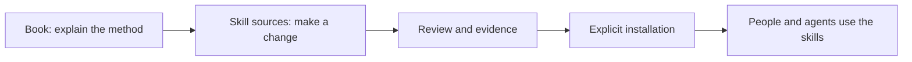

# Repository Charter

[ALP Skills Book](../README.md) · Previous:
[Native Worker Delegation](worker-dispatch.md) · Next:
[Canonical Sources and Installation](canonical-sources-and-installation.md)

## What this repository is for

ALP Skills is the home for the reusable instructions and tools that support the
ALP method. It contains the Book that explains how the method works, the
reviewed sources of the skills themselves, and the material needed to improve
them without losing the reasoning behind a change.

It is not an application template, a replacement IDE, or a new agent swarm.
Think of it as a small workshop for maintaining the method: the place where a
skill can be understood, changed carefully, reviewed, and released.

## Two ways to use ALP Skills

Most readers need only one of these paths.

| If you want to… | Start here | What you need |
| --- | --- | --- |
| Use the skills in a project | The Book and the installation guidance. | An installed copy. You do not need to clone or modify this repository. |
| Improve a skill or its supporting tools | This repository's Book and canonical source tree. | A checkout, an approved governing change, and an explicit installation step after review. |

The second path follows ordinary software-maintenance discipline. Import the
known active version into the canonical source tree, make and review the change
there, then explicitly install the reviewed result. This prevents a useful
fix from existing only as an unreviewed edit to one person's live setup.

## What the Book governs

The Book is written for people first. It explains the intent, rationale,
boundaries, and material behavior of the skills. For Full ALP work, it is also
the source from which an AI can tangle implementation without inventing a
material decision.

The repository wiki has a different job and is introduced in the final chapter.
It is an agent's repository-local working memory: a place for reconciled
lessons, source provenance, and wrap-up knowledge. It is not a second Book and
must not silently overrule one. A reader should be able to understand the
method from the Book without relying on the wiki.

## What changes here

The canonical source tree carries the active workflow, authoring companion,
implementation companion, capability profiles, native worker-delegation
guidance, and deterministic helpers. Later corrections happen in that tree;
installation stays an explicit, recoverable action.

This repository does not automatically install a change, replace unrelated
configuration, publish a remote, or archive an earlier framework. Before
publication, the separate knowledge-lifecycle decision must explain how
portable guidance, per-clone bindings, and condition-bound knowledge remain
distinct.

## Acceptance for the source-management release

The release is ready when the canonical tree contains an identifiable active
baseline, a correction can be reviewed there without editing a live installed
copy, and an installation requires an explicit action. The existing Book,
repository guide, and provenance-first wiki provide the durable context for
that work.

---

[ALP Skills Book](../README.md) · Previous:
[Native Worker Delegation](worker-dispatch.md) · Next:
[Canonical Sources and Installation](canonical-sources-and-installation.md)
