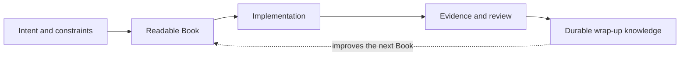

# What Is ALP?

[ALP Skills Book](../README.md) · Previous: [README](../README.md) · Next:
[Delivery Workflow](delivery-workflow.md)

## Literate programming in brief

Literate programming is the older idea that a program should be written for
human understanding, not laid out only in the order a compiler or interpreter
needs. Donald Knuth described the programmer's job as explaining to human
beings what the computer should do, and argued that concepts should arrive in
the order that best serves the reader. Classic systems such as WEB and CWEB
combine prose and source code, then produce both a human-facing document and
the compilable program. [Knuth's overview](https://cs.stanford.edu/~knuth/lp.html)
and [CWEB page](https://cs.stanford.edu/~knuth/cweb.html) are good starting
points for readers who want the original tradition.

ALP keeps the reader-first ambition but changes the practical boundary. A
traditional literate program may include all of its source in the document. An
ALP author chooses the precision the decision needs: a short intention, a
specification, a diagram, flowchart, pseudocode, literal algorithm, or actual
code. Details that are genuinely routine may be left to an AI implementation;
details where a wrong choice would matter must be stated precisely. The result
is a spectrum, not a choice between an unstructured prompt and reproducing an
entire codebase in prose.

## The problem ALP is trying to solve

An AI agent can produce code very quickly. That is useful, but it also makes it
easy to lose the reason a system behaves as it does. A later agent sees files,
tests, and perhaps a recent conversation, then has to guess which details are
intentional and which are accidental. The code becomes the only story left.

AI-Assisted Literate Programming (ALP) keeps a second, human-facing artifact:
the **Book**. A good Book explains the outcome we want, why it matters, the
constraints that shape it, and the behavior that must not change. Code is the
working implementation of that explanation, not the hidden place where intent
is reconstructed.

This does not mean that code is disposable or that documentation must imitate
code. The Book should make a careful reader understand the system more easily
than reading its implementation, while still being precise enough to constrain
an AI-assisted tangle where that precision matters.

## When a Book is the right tool

Full ALP is most valuable when a design has lasting rationale, meaningful
compatibility or failure behavior, or enough complexity that a future reader
would otherwise need to reverse-engineer intent. It asks the author to teach in
reader order: why the system exists before how it happens to be arranged.

But the choice is not only about task size. Full ALP asks its author to think
like a teacher and writer, not only like a programmer: build a reader's mental
model, choose what must be exact, and explain the reasoning behind it. Some
people will prefer the more familiar discipline of a technical specification
while still benefiting from the workflow, review, and evidence practices.

Time matters too. A deadline can make a good Book impractical even when it
would be valuable; that is a form of documentation debt, not a reason to block
the work. The practical alternative is an honest specification and a recorded
follow-up, not pretending that an insufficient Book received the same care.

## ALP, specification-driven work, and small changes

| Approach | Primary artifact | Best fit | What it avoids |
| --- | --- | --- | --- |
| Full ALP | A readable Book that is also tangle-ready. | The author can invest in reader-first explanation and the behavior warrants it. | Treating code as the unstated design. |
| Spec-driven | A concise behavioral or technical specification. | A practical or preferred alternative when time or authoring style does not support a full Book. | Starting implementation from an ambiguous request. |
| Mechanical | An explicit decision that no new governing document is needed. | Small, behaviorally obvious work allowed by local guidance. | Pretending that a minor edit needs a miniature Book. |

All three approaches can use tests, review, and operational evidence. TDD is
encouraged when a meaningful executable oracle is practical; it is not a rule
that overrides real static, manual, runtime, telemetry, or rollback evidence.

Specification-driven work is still farther from unstructured “vibe coding”
because it makes desired behavior visible before implementation. ALP goes
further by making the explanation itself a reader-first, durable part of the
system.

## Why there is a delivery workflow

Think of the workflow as the habit that stops a useful explanation from being
left behind. It gives an agent a moment to ask, “What am I changing, what
already governs it, and how will we know that the change worked?” before it
starts editing files. It then leaves a short trail of evidence and a lesson the
next person or agent can use.

For Full ALP, the essential promise is simple: when a Book chapter governs an
implementation artifact, do not quietly change the artifact and abandon the
chapter. For specification-driven work, the same habit keeps the specification,
implementation, and acceptance evidence from drifting apart. For a small
Mechanical change, it helps us state why no new governing document was needed.

The workflow also offers bounded delegation, explicit acceptance oracles,
independent review, and wrap-up knowledge. Those are useful tools for working
carefully with AI agents; they support the design rather than becoming the
subject of the work.

## Learning from other specification-driven systems

GitHub's [Spec Kit](https://github.github.com/spec-kit/) is a current external
reference worth evaluating. Its default sequence is specification, plan,
tasks, and implementation; it also treats project principles as a durable input
to later phases. This repository has not adopted Spec Kit or its templates.
The useful question for the Priority 1 comparison is which of its ideas improve
clarity or portability here without replacing the Book, phase ownership, or
evidence model. That comparison should include other relevant systems, not
assume that one toolkit supplies the answer.

The supporting research record is [Spec-driven development research](../wiki/sources/spec-driven-development-research-2026-07-19.md).

---

[ALP Skills Book](../README.md) · Previous: [README](../README.md) · Next:
[Delivery Workflow](delivery-workflow.md)
