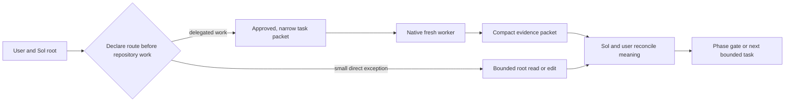

# Native Worker Delegation

[ALP Skills Book](../README.md) · Previous:
[EC Linter](ec-linter.md) ·
Next: [Repository Charter](repository-charter.md)

## Why delegation is native now

For the sake of saving token credits (or more direct costs if you are using the
API), our workflow makes use of workers that can inspect a broad repository,
implement an approved boundary, or independently challenge a result without
filling the root conversation with command output and local detail. The former
Python/App Server dispatcher was a workaround for a broken version of
`spawn_agent` in some versions of Codex. Native `spawn_agent` delegation has
now supplied the needed worker boundary directly, so we retire that workaround
rather than maintaining two internal delegation transports.

Native delegation is one of two common Implementation routes. It is the
internal route for bounded Codex work. A manual or external handoff to
Antigravity, or where appropriate Gemini Flash, instead uses the complete,
revisioned EC governed by [Execution Contracts and Evidence](execution-contracts-and-evidence.md).
Both routes implement the same approved intent, but they do not share a
transport or envelope.

The root uses native delegation to give a fresh worker a small, self-contained
packet and receives a compact evidence packet in return. This is a context and
assurance design, not a claim that a worker is infallible. Root-context
minimization is a primary constraint: broad repository discovery and noisy
evidence belong with the bounded worker, while the root receives only the
conclusion needed to make the next material decision.

This chapter governs the native route's delegation policy and outcomes, not a
particular native-tool call form or the manual EC route. Platform invocation
details may evolve; an implementation must use the native surface so that the
worker receives no broader repository or conversation context than the
approved packet requires.
It must not recreate an App Server bridge, a Python dispatcher, a daemon, a
scheduler, a transcript store, or another orchestrator.

## The authority boundary

> [!note]
>
> Model names assume OpenAI and Codex, as of July 2026. We might reword this to be more generic in the future, or simply keep it up to date with current model names and roles.

**Sol is the default root orchestrator.** Sol and the user own the material
thinking: user dialogue, material decisions, scope, phase gates, delegation,
the meaning of acceptance, reconciliation of the compact worker reports, and
final synthesis. Selecting a worker does not transfer any of those powers.

Sol may directly read one named repository artifact when it needs the complete
contents rather than a summary, or one or two known artifacts when they are
reasonably small. It may also make a genuinely small localized edit when no
test, broad follow-on inspection, iterative repair, or material design choice
is implied.
Direct confirmation is limited to inspecting the localized diff or another
constant-cost observation. Sol stops and delegates the remaining bounded work
as soon as discovery, noisy output, validation, iteration, or broader evidence
becomes necessary.

This narrow exception does not authorize Sol to perform substantial
implementation, run tests or builds, conduct broad deterministic verification,
or review its own or another worker's result. Sol may continue to inspect an
independently authored test specification or test file only to confirm that it
expresses user-approved requirements; that check does not decide whether an
implementation passes.

During an explicitly approved Full ALP Governing Documentation phase, Sol may
author or revise the governing Book beyond the small-edit safe harbor. This is
the expression of root-owned material intent, not implementation authority.
Sol delegates bounded evidence gathering and mechanical checks where economic,
does not delegate material policy choices, and stops at an unapproved design
gap.

The **root Sol orchestrator** is not the separately spawned
`alp_escalation_reviewer` worker, even though both use Sol. The retained
profile is a fresh, read-only escalation-review worker. It may perform a full
repository review only when the user explicitly authorizes that particular Sol
review. Its profile text can never enlarge the root Sol orchestrator's
direct-work safe harbor or governing-authoring authority. Terra remains the
normal, default fresh reviewer to conserve credits. The root may recommend a
Sol escalation review when risk
or an oracle limitation warrants it, but neither risk nor a weak oracle starts
one automatically: explicit user approval is required.

Luna handles bounded discovery, summarization, routine documentation, implementation,
and deterministic verification. Terra handles repository work that needs
stronger judgment and every normal independent review. Existing native
capabilities or profiles may be chosen according to task risk, but they do not
alter this authority map and this chapter creates no new orchestrator profile.
The retained escalation-review profile already represents a separately spawned,
user-authorized Sol worker and remains unchanged by this revision.

| Actor | May do | Must not do |
| --- | --- | --- |
| User and Sol root | Set and revise approved intent; author approved Full ALP governing documentation; select bounded work; approve phases; reconcile compact reports; decide acceptance and final synthesis; directly read one named artifact needed in full, one or two known small artifacts, or make a localized edit inside the economic safe harbor. | Delegate material governing choices; let the safe harbor expand into discovery, testing, substantial implementation, iterative repair, broad verification, or review; treat a worker report as self-proving. |
| Luna worker | Bounded discovery, extraction, routine documentation, implementation, and deterministic verification within an approved packet. | Author material Full ALP intent; decide material design, phase authority, scope expansion, acceptance, or recursive delegation. |
| Terra worker | Stronger-judgment repository work and the default fresh independent review; when the root packet explicitly permits it, use one fresh Luna child for bounded read-only mechanical or noisy evidence gathering. | Transfer its assigned judgment, review, or semantic inspection to Luna; take the root's material-decision, phase, scope, or acceptance authority; create any other delegation hop. |
| Separately spawned Sol escalation reviewer | A full, fresh, read-only repository review after explicit user authorization for that review. | Act as root Sol, start from risk or a weak oracle alone, edit, delegate, authorize a phase, or decide acceptance. |

Platform-mandated instruction reads are outside this repository-work policy;
this chapter does not try to govern them.

## Route by weighted credit cost

The economic objective is to preserve expensive root context and minimize
weighted credit consumption while retaining enough judgment to avoid drift and
repair. Raw token minimization is the wrong objective when a cheaper worker can
consume more tokens for less credit cost.

As of July 2026, the published GPT-5.6 token-credit rates give the relative
heuristic Sol:Terra:Luna = approximately `5:2.5:1` across input,
cached-input, and output tokens. Luna can therefore consume about five tokens
for the cost of one Sol token, or 2.5 tokens for the cost of one Terra token,
within the corresponding token category before handoff and repair overhead. The
[official rate card](https://learn.chatgpt.com/docs/pricing#what-are-tokens-and-credits)
also warns that model choice, context, reasoning, tools, retrieval, and caching
affect actual use. The ratio is a dated routing prior and must be rechecked when
models or pricing change; it is not a promise that every delegated task is
cheaper.

Before the first repository action, Sol states the selected route and its
reason in one short line. The declaration makes systematic under-delegation
visible without requiring cost arithmetic or workflow bookkeeping.

| Situation | Default route | Reason |
| --- | --- | --- |
| One named artifact is needed in full rather than summarized, or one or two known artifacts are reasonably small. | Direct Sol safe harbor. | A Luna summary would be a relay or the material already fits the root decision. |
| One genuinely small localized edit needs no test, discovery, iteration, or material choice. | Direct Sol safe harbor with constant-cost confirmation. | Packet and reconciliation overhead would dominate the edit. |
| An approved Full ALP Book must encode material intent. | Sol authors; Luna may gather bounded evidence or run mechanical checks. | Governing wording is root-owned judgment, not an implementation task or safe-harbor exception. |
| Discovery spans several files or the answer location is unknown. | Fresh Luna. | Broad inspection belongs in cheaper context. |
| Commands, tests, logs, large diffs, or structured data may produce noisy output. | Fresh Luna. | Luna can compress the evidence before it reaches the root. |
| An approved implementation needs validation or repair iteration. | Fresh Luna implementer, followed by the required independent review. | Execution volume is cheaper outside the root while intent stays governed. |
| Repository work needs stronger judgment or independent semantic review. | Fresh Terra. | The task needs more judgment than Luna should supply, without paying Sol rates for ordinary review. |

The safe harbor is continuously conditional. If a direct read exposes a need
for search, another substantial artifact, tests, broad verification, or
iterative repair, Sol stops before doing that work and delegates the remaining
bounded task. Conversely, a named one-line change is not delegated merely to
increase worker use.

Native work is sequential by default. The workflow has no preferred worker
count and no swarm objective; parallel workers remain an explicit exception
for independent boundaries and useful quota headroom. Cursor's 2026
[agent-swarm experiment](https://cursor.com/blog/agent-swarm-model-economics)
supports the direction of keeping expensive planning separate from cheaper
execution and shows that poor coordination can erase savings. Its autonomous,
large-scale results do not establish thresholds for this workflow's ordinary
zero-to-ten, mostly sequential worker sessions.

## A narrow packet, not a borrowed transcript

Before native delegation, Sol makes the delegation decision and prepares a
standalone packet. It contains only the approved task, role or capability,
exact repository boundary, supplied evidence or relevant paths, allowed
permissions, stop conditions, and the required compact response. A worker
starts with fresh, narrow context rather than the root transcript. It may read
and act only inside the packet boundary and reports a conflict rather than
silently widening it.

Narrow context does not require an artificially tiny evidence boundary. The
packet may authorize broad inspection inside one bounded decision subtree when
that lets Luna resolve the question without repeated root handoffs. The return,
not the worker's useful exploration budget, is kept compact. The packet must
not ask a worker to decide two overlapping material questions or make another
worker absorb the same evidence merely to relay it.

> [!important]
>
> Codex's `spawn_agent` tool may *require* not sharing the context with the root in order to allow specifying a different model and reasoning effort. Therefore the decision here is not only for isolation, but probably necessary for this to work at all.

Every response distinguishes at least:

- conclusion or current status;
- concrete evidence and commands or observations where applicable;
- uncertainty or a precise blocked reason;
- inspected scope; and
- uninspected scope.

Implementation and review packets additionally identify changed files or the
reviewed diff, oracle results, deviations, and residual risks. Raw command
logs, broad repository listings, and a worker's private reasoning are not a
root response format. Sol reconciles these compact reports with the user; it
does not rerun their checks or independently inspect their implementation
evidence.

Freshness and narrow packets protect correctness, independent judgment, and
root context. They are not a secrecy boundary and do not enlarge any native
permission ceiling.

Native `spawn_agent` does not provide an enforceable task timeout, so a timeout
is omitted by default and must not be presented as a control the workflow can
guarantee. A packet may include an advisory time budget or checkpoint
expectation when useful. It must be labelled advisory: reaching it requests a
status or root decision but does not prove interruption, cancellation, or
worker termination.

## One controlled Terra-to-Luna hop

Workers remain non-recursive by default. The sole experiment is a one-hop
exception that the root must authorize in the Terra packet. An authorized
Terra worker may create one fresh Luna child, sequentially, for a bounded
read-only mechanical or noisy evidence task that Terra would otherwise have to
perform itself. Suitable child work includes focused search, structured
extraction, approved deterministic checks, and compression of command, test,
or log output.

Terra remains responsible for its assigned conclusion. A Terra reviewer must
personally inspect the governing source, relevant diff, and evidence necessary
for semantic judgment; it cannot cite the Luna packet as a substitute for its
own review. The child cannot edit, decide material meaning, expand scope,
authorize a phase, assess acceptance, or delegate again. Terra reports that it
used the child and reconciles the compact child evidence into its own single
return.

The permission is per Terra assignment, not a standing capability. A child
failure or material gap produces a blocked Terra return; it does not authorize
a second child, an automatic retry, a fallback route, or a wider investigation.
No Luna worker, root or escalation Sol reviewer, or other profile receives
recursive authority from this exception. Whether the experiment actually
saves credits remains a qualitative daily-use judgment until representative
experience justifies a stronger claim.

## Native delegation lifecycle

The normal lifecycle is deliberately short and has one owner at every point.

1. **Declare route, gate, and packet.** Before repository work, Sol declares a
   direct safe-harbor route or a suitable worker route. Sol and the user retain
   the approved phase, scope, acceptance meaning, and stop conditions. A worker
   receives one narrow packet; a Terra packet explicitly says whether the
   one-child experiment is authorized.
2. **Bounded work.** Direct Sol work stops when the safe harbor ceases to
   apply. A worker performs only the packet's repository work. An authorized
   Terra may use the single Luna evidence child described above. Otherwise it
   neither delegates nor changes the task to work around a problem.
   It may stop at a contradiction, missing authority, scope conflict,
   unavailable native capability, or failed approved oracle.
3. **Compact return.** The worker returns the required evidence packet. A
   blocked packet is useful evidence; it is not a result to hide with a
   transcript replay or an automatic fallback.
4. **Root decision.** Sol and the user reconcile the packet. They may clarify
   requirements, approve a new bounded attempt, return to the appropriate
   phase, or stop. A new attempt is a new root decision, not a worker retry
   loop.

Each delegated unit therefore has one root packet, one worker attempt, one
compact return, and one reconciliation. The controlled Terra child occurs
inside that one attempt and does not create a second root reconciliation path.

If native delegation fails before useful work begins, the failure is reported
as such. It does not revive the retired dispatcher, widen Sol's direct-work
safe harbor, authorize a worker to broaden scope, or make a failed task appear
complete. If recovery would change design, scope, phase, permissions, or
acceptance, the root returns to the user for that decision. Native delegation
has no separate diagnostic service, raw protocol log, persistent worker state,
or dispatcher-specific retry and timeout protocol to preserve.

## Independence before trust

Less-capable workers are useful but are not trusted merely because they say a
change succeeded. Before implementation, a separate fresh Luna or Terra worker
owns the approved test or oracle semantics whenever that independence is
practical. The implementer runs an executable oracle without weakening or
redefining it. When the behavior is English policy rather than executable
logic, the honest oracle is fresh Terra semantic review supported by cheap
deterministic link, navigation, and focused static checks.

The controlled Luna evidence child does not weaken reviewer independence.
Terra may use it for supporting mechanical evidence only and must personally
perform the semantic comparison that makes the review independent. Direct Sol
safe-harbor edits do not let Sol review its own work; the existing rule that
every non-trivial change receives a fresh review remains unchanged.

This workflow does not commit a bespoke Python test that pretends to prove the
meaning of prose. One-off verifier commands may provide repeatable evidence
about links, headings, file presence, or forbidden terms; Terra still judges
whether the governing policy and implementation agree. Sol reconciles Terra's
compact review report with the user but does not rerun checks or inspect the
diff and raw evidence personally. A weak, missing, or failed oracle is a reason
to withhold acceptance or return to the appropriate phase.

## What native delegation does not change

Native spawning changes the transport only. The ALP phase gates and all three
delivery strategies remain in force:

| Invariant | Required behavior |
| --- | --- |
| Strategy | Brainstorm still selects Full ALP, Spec-driven, or Mechanical work; native delegation does not select a strategy. |
| Governing intent | A Book or specification remains the source of approved design. A worker stops at a material gap rather than deciding it. |
| Phase authority | Only Sol and the user move work between Brainstorm, Governing Documentation, Implementation, review, and Wrap Up. |
| Scope | A packet's file and action boundary is closed. A necessary extra file, permission, or changed oracle meaning is a reported conflict. |
| Acceptance | Native or external implementation completion is evidence, not acceptance. Sol and the user retain the acceptance decision after the required independent review. |
| Delegation | Workers do not recursively delegate except for one root-authorized Terra-to-one-Luna read-only evidence hop. That exception creates no further hop, orchestrator, retry, or escape from stop conditions. |
| External route | A manual EC handoff may be selected without changing approved intent; its revision, planning, and acknowledgment mechanics remain governed by the EC chapter. |

The user-provided successful native-spawn observation is valuable runtime
evidence that this replacement route exists. It is not a repository oracle and
does not remove independent oracle ownership or fresh-review requirements.

## Implementation boundary for delegation economics

The later Implementation encodes this chapter without reopening the two-route
design or synchronizing installed artifacts. Its closed repository boundary is:

- `codex/skills/alp-workflow/SKILL.md`: keep the always-loaded workflow concise
  while making the weighted-credit objective, dated `5:2.5:1` heuristic,
  before-work route declaration, Luna-default triggers, direct Sol safe harbor,
  stop-and-delegate transition, sequential default, and one-hop exception hard
  to omit. Existing phase, authority, oracle, review, Wrap Up, and safety rules
  remain in force.
- `codex/skills/alp-workflow/references/native-worker-delegation.md`: carry the
  detailed route table, broad-inspection/compact-return distinction, one
  packet/attempt/reconciliation lifecycle, direct-work boundary, sequential
  default, and controlled Terra-to-Luna mechanics.
- `codex/agents/alp_reviewer.toml`: replace its absolute no-delegation rule only
  with the root-authorized one-fresh-Luna, read-only evidence exception. Terra
  remains read-only, retains semantic judgment, and receives no phase or
  acceptance authority.
- `codex/skills/alp-workflow/references/handoff-contract.md` and
  `antigravity/skills/alp-contract-implementation/SKILL.md`: keep deterministic
  EC lint and direct Sol/user plan authorization, remove mandatory EC semantic
  preflight and pre-implementation Terra plan review, and retain the fresh
  independent review after implementation evidence exists.
- `TODO.md` during Implementation or Wrap Up: remove the fulfilled delegation-
  economics and Cursor-evidence reminders. Preserve unrelated follow-ups and
  do not decide whether this work also fulfills the separate deeper-manual-
  review reminder without user acceptance.
- `wiki/repository-foundation.md` and `wiki/log.md` during Wrap Up: record the
  accepted economic routing policy and the limited nature of the Terra-to-Luna
  experiment. Historical `wiki/sources/**` remains evidence, not current
  guidance.

The manual EC envelope, revision rules, read-only planning boundary,
acknowledgement, implementation stop conditions, completion evidence, and user
authorization remain unchanged. The review reference, all Luna profiles, the
Sol escalation-review profile, and installed or external artifacts remain
unchanged. No installation or synchronization is authorized.

### Non-operative deletion targets

The closed boundary also contains these exact deletion targets:

- `codex/skills/alp-workflow/scripts/dispatch_worker.py`
- `codex/skills/alp-workflow/scripts/test_dispatch_worker.py`

Both files are deleted without an archive, fallback, compatibility shim, or
replacement policy or prose oracle. These literal paths identify removal only;
they are not active commands, transports, or compatibility entry points.

The separately user-approved deletion of the untracked
`test_native_worker_delegation.py` also remains in force. That one-off file
stays absent and is not a governed artifact to recreate, replace, or maintain.

The former dispatcher remains retired and absent; this revision must not
restore its code, tests, transport, fallback, or protocol.
Only the canonical Terra reviewer profile changes as described above. Other
worker profiles remain unchanged. The handoff reference and Antigravity
companion change only in their pre-implementation review sequence.

There is no rollback that silently restores the dispatcher or collapses both
routes into one envelope. If native delegation or external handoff proves
insufficient, Sol and the user reopen Brainstorm and approve a new design.

## Acceptance for delegation economics and the two-route workflow

English-policy acceptance uses a fresh delegated Terra semantic review plus
cheap deterministic link, navigation, and focused static checks. One-off
verifier commands may support the evidence packet, but they do not decide
policy meaning.

| Criterion | Acceptance evidence | Limitation |
| --- | --- | --- |
| Economic routing happens before repository work and prefers Luna for broad or noisy execution without forcing universal delegation. | Terra traces the route declaration, Luna-default triggers, direct Sol safe harbor, approved governing-authoring responsibility, safe-harbor exit, sequential default, and no-worker-count objective from this Book into the concise skill and native reference. Representative static scenarios cover Full ALP authoring with delegated evidence gathering, a named artifact needed in full, a small known-file read, a localized edit, multi-file discovery, noisy test output, and validated implementation. | Static policy cannot prove that future roots will route consistently or that a particular task saved credits. |
| The dated credit heuristic remains visible and honest. | Focused text checks find `5:2.5:1`, weighted-credit rather than raw-token language, the official pricing link, and the revalidation caveat in the Book and always-loaded skill. | Pricing may change after review; the heuristic does not predict tool, reasoning, retrieval, caching, briefing, or repair cost. |
| Terra can use exactly one Luna evidence child without outsourcing judgment or creating a swarm. | Terra compares the Book, native reference, and `alp_reviewer.toml`; focused checks require explicit root authorization, one fresh read-only Luna child, sequential execution, Terra's personal semantic inspection, no Luna recursion, and blocked failure without retry or fallback. | Static configuration does not demonstrate that nested native spawning is reliable or net-positive in representative sessions. |
| Worker evidence can be broad enough to resolve one bounded question while the root return stays compact. | Terra checks packet and return rules plus representative multi-file and noisy-output scenarios; the return contract still requires conclusion, evidence, uncertainty, and inspected/uninspected scope. | A prose boundary cannot mechanically prevent an over-broad packet or an over-compressed return. |
| Both Implementation routes are usable and share the right invariants. | Terra compares the Book, final diff, concise core, all three operational references, and the Antigravity companion; a link check proves every referenced file is present and reachable. | Link existence cannot prove correct route semantics. |
| Native packets stay small and truthful to `spawn_agent`. | Terra checks the required packet fields, fresh context, blocked/failure behavior, and advisory-only time budget; a focused static check rejects a mandatory or enforceable native timeout. | This does not execute a live native worker. |
| Manual EC handoff is restored without becoming a native envelope or duplicating semantic review before a diff exists. | Focused checks cover revisioning, compatibility, optional questions, deterministic lint, direct Sol/user plan authorization, acknowledgement, test-update limits, completion evidence, and the single fresh post-implementation Terra review against the EC chapter. | The EC linter proves mechanical structure only; direct plan review cannot prove implementation conformance, which remains the post-implementation review's role. |
| Contextual detail moved without weakening the core. | Terra traces every required core invariant into `SKILL.md` and each route/review behavior into exactly one referenced document; static checks resolve links and detect duplicated dispatcher or mandatory-timeout guidance. | Concision and adequate emphasis remain judgment calls. |
| Retired mechanisms and fulfilled follow-up stay retired. | A focused repository scan confirms no active dispatcher route or bespoke native-delegation Python policy test; TODO inspection confirms the fulfilled Antigravity/Gemini reminder is gone and the deeper manual-review TODO remains. | Static absence cannot prove an external installation or runtime state. |

Book and active-guidance link checks cover README, all Book chapters, the
workflow skill, and its references. Focused terminology checks cover the same
active surfaces plus worker profiles, TODO, and current wiki pages. Historical
dispatcher evidence remains allowed only in `wiki/log.md`, `wiki/sources/**`,
and the explicitly labelled section below; an allowance must never hide an
active command, transport, fallback, or authority rule. Normative prohibitions
outside those historical regions may name the retired mechanism only to forbid
its restoration; they are not historical allowances or active routes.

## Reconciled legacy evidence

The imported canonical baseline contained a Python `dispatch_worker.py`, its
dedicated deterministic tests, and `alp-workflow` text that invoked an App
Server. That is observed legacy implementation evidence, not continuing
forward intent. Earlier Book and source text described packet validation,
routing, diagnostics, retries, and terminal envelopes for that adapter. The
approved design replaces all of those dispatcher-specific mechanics with the
native lifecycle above; they are neither compatibility requirements nor a
fallback contract.

This chapter therefore preserves the history only to explain removal. It does
not erase evidence by pretending the adapter never existed, and it does not
make its old protocol a requirement for native workers.

---

[ALP Skills Book](../README.md) · Previous:
[EC Linter](ec-linter.md) ·
Next: [Repository Charter](repository-charter.md)
