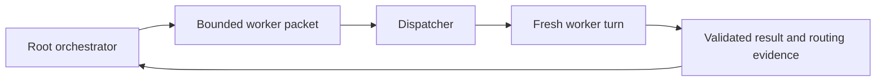

# Worker Dispatch

[ALP Skills Book](../README.md) · Previous:
[EC Linter](ec-linter.md) ·
Next: [Repository Charter](repository-charter.md)

## Why dispatch needs a visible boundary

The dispatcher exists because the native Codex sub-agent surface no longer
reliably lets the main thread select a worker's model and reasoning effort. ALP
needs those choices to be visible and bounded: a low-cost explorer is useful
only if the root can prove which role, effort, permissions, and result it
actually received. The dispatcher is the temporary adapter around that missing
native capability. If Codex later exposes equivalent named-role selection and
runtime evidence directly, this adapter can be retired without changing the
workflow's policy.

The workflow can ask a bounded worker to explore, verify, tangle, implement, or
review. That is only useful when the root can tell what actually happened:
which role was selected, which permissions applied, whether the requested model
was rerouted, whether the turn timed out, and what evidence returned.

The dispatcher is the small adapter that provides this visibility. It is not a
daemon, a scheduler, a transcript store, or a second workflow owner. The root
session still selects the role, sets the task boundary, reconciles results, and
decides whether the result satisfies acceptance.

## A bounded packet

Every dispatch states the role, task, working directory, sandbox ceiling,
timeout, relevant paths or evidence, stop conditions, and a closed response
contract. The worker receives fresh task context by default; it does not decide
material design, phase transitions, scope expansion, or acceptance.

The response must distinguish conclusion, evidence, uncertainty, inspected
scope, and uninspected scope. A `blocked` result is useful evidence, not an
error to hide by replaying the same ambiguous task.

## Modes and observable behavior

Normal dispatch accepts one packet and produces one compact normalized result.
It reports lifecycle progress on standard error without repeating the packet or
worker output, and writes the terminal result on standard output. A
newline-terminated packet from standard input begins work without waiting for
end-of-file.

Caller-authorized diagnostic mode may write raw App Server protocol and child
standard error to a new, mode-0600 log outside the packet working directory.
The caller chooses and reviews that log; normal operation creates no default
transcript. A startup-probe mode stops after initialization, account
classification, and model-catalog access: it creates no worker thread or turn,
so it can distinguish startup trouble from a task failure.

These modes are part of the dispatch contract. They do not widen the worker's
sandbox, give it the root transcript, or turn diagnostics into a persistent
service.

## Fail clearly rather than guess

The dispatcher validates the selected profile and runtime before starting a
turn, fails closed on a routing mismatch, interrupts a timeout once, and does
not continue a timed-out turn. Only an early transport failure may receive one
local restart. A later replacement is a fresh root decision, not an automatic
retry loop.

The deterministic dispatcher tests cover packet validation, routing mismatch,
reroute interruption, timeout behavior, invalid responses, and stable failure
statuses. Live read-only dispatch provides the separate evidence that the
observable runtime works in the real orchestrator path.

## Current acceptance boundaries

The governing behavior preserves four important limits:

| Boundary | Required behavior |
| --- | --- |
| Terminal result | A started turn is progress, not success; normal dispatch ends only with a valid normalized terminal result or a stable failure. |
| Notification order | A valid `turn/started`, agent message, and completion may arrive before the matching start reply and must still yield the terminal response. |
| Timeout and reroute | One timeout interrupt ends that turn; a reroute fails closed. Neither is silently continued. |
| Review findings | Reviewer packets state the session goals. Every finding says whether it is deferrable without affecting them; only the root and user may actually defer it. |

The deterministic suite is the regression oracle for those limits. A bounded
real read-only dispatch is the separate usability oracle. Future changes must
update this chapter before implementation whenever they alter a command mode,
result shape, safety boundary, timeout/reroute rule, or diagnostic behavior.

## Diagnostics and future correction

Normal operation returns compact lifecycle and result evidence. A
caller-authorized diagnostic mode may preserve raw protocol or child-stderr
evidence for manual inspection when a runtime problem needs diagnosis. It is
not a secrecy boundary, and it must not make a missing terminal result look
like successful exploration.

The next dispatcher repair will begin from the canonical imported baseline and
will update this chapter before implementation if it changes the dispatch
contract, safety boundary, or observable behavior.

---

[ALP Skills Book](../README.md) · Previous:
[EC Linter](ec-linter.md) ·
Next: [Repository Charter](repository-charter.md)
